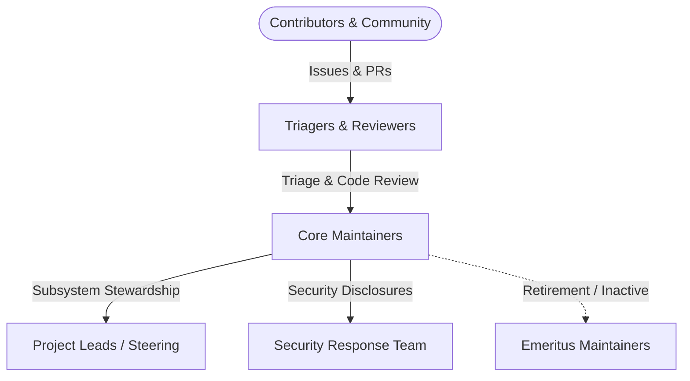

# NOVA Project Maintainers & Governance Charter

This document outlines the governance structure, maintainer roles, responsibilities, decision-making processes, code review service-level agreements (SLAs), and the path to maintainership for the **NOVA** project.

---

## Table of Contents

- [Core Principles](#core-principles)
- [Maintainer Roster](#maintainer-roster)
- [Roles & Responsibilities](#roles--responsibilities)
  - [Project Leads & Steering Committee](#project-leads--steering-committee)
  - [Core Maintainers](#core-maintainers)
  - [Triagers & Reviewers](#triagers--reviewers)
  - [Security Response Team (SRT)](#security-response-team-srt)
  - [Emeritus Maintainers](#emeritus-maintainers)
- [Decision-Making & Consensus Model](#decision-making--consensus-model)
  - [Lazy Consensus](#lazy-consensus)
  - [Voting Thresholds](#voting-thresholds)
- [Review & Operational SLAs](#review--operational-slas)
- [Path to Maintainership](#path-to-maintainership)
  - [From Contributor to Reviewer](#from-contributor-to-reviewer)
  - [From Reviewer to Core Maintainer](#from-reviewer-to-core-maintainer)
- [Maintainer Standards & Invariants](#maintainer-standards--invariants)
- [Inactivity & Emeritus Transition](#inactivity--emeritus-transition)
- [Maintainer Operational Playbooks](#maintainer-operational-playbooks)

---

## Core Principles

1. **Defensive Systems Reliability:** NOVA powers mission-critical inference pipelines. Reliability, deterministic execution, and low-latency throughput always supersede rapid feature accumulation.
2. **Strict Architectural Isolation:** Core subsystems (`src/queue`, `src/relay`, `src/pool`, `src/db`) must remain strictly bounded. Zero parent directory imports, zero client UI bloat in backend queues, and zero external runtime dependencies (such as Redis or BullMQ) are tolerated.
3. **Radical Transparency:** Architectural choices, post-mortems, and governance decisions are documented in public Architecture Decision Records ([docs/adrs/](file:///Users/bozoegg/Downloads/nova/docs/adrs)) and blameless retrospectives ([docs/post-mortems/](file:///Users/bozoegg/Downloads/nova/docs/post-mortems)).
4. **Security by Default:** Zero-leak privacy firewalls, hardware-grade AES-256-GCM envelope encryption, and private vulnerability coordination are non-negotiable.

---

## Maintainer Roster

The active maintainers of the NOVA repository are listed below:

| Name / GitHub Handle | Role | Focus Area | PGP Key Fingerprint |
| :--- | :--- | :--- | :--- |
| **[@CardSorting](https://github.com/CardSorting)** | Project Lead / Steering | Core Engine, Architecture & Cryptography | `9E4F 821C 4D7A 6B30 15F8 77D9 3A21 E8B4 56C0 119A` |
| **NOVA Core Team** | Core Maintainers | Protocol Relay, Credential Pools, DB Substrate | Multi-Sig / Hardware FIDO2 Enforced |
| **NOVA Security Response Team** | Security (SRT) | Vulnerability Triage & Coordinated Disclosure | `security@nova-relay.internal` |

---

## Roles & Responsibilities



### Project Leads & Steering Committee
- **Scope:** Overall project vision, governance amendments, cryptographic release signing, and binding dispute resolution.
- **Authority:** Final authority on architectural direction, trademark/licensing, and security embargoes.
- **Commitment:** Continuous project stewardship, active participation in major decision votes, and mentoring core maintainers.

### Core Maintainers
- **Scope:** Daily stewardship of repository health, pull request reviews, feature merges, and release engineering.
- **Authority:** Full repository write access, branch protection bypass for emergencies (requiring post-incident notification), and npm/container release triggers.
- **Obligations:**
  - Maintain active engagement in issue/PR queues.
  - Strictly enforce architectural invariants and test coverage.
  - Review PRs within the maintainer SLA (< 48 hours).

### Triagers & Reviewers
- **Scope:** First line of defense in issue and pull request handling.
- **Authority:** Labeling issues, closing duplicate or non-reproducible tickets, requesting changes on pull requests.
- **Obligations:**
  - Verify reproductions using native Node.js test runners.
  - Check submissions against the [Contributor PR Checklist](file:///Users/bozoegg/Downloads/nova/CONTRIBUTING.md#pull-request-checklist).
  - Escalate potential vulnerabilities immediately to the Security Response Team.

### Security Response Team (SRT)
- **Scope:** Triage, validation, patch development, and coordinated disclosure of security vulnerabilities.
- **Authority:** Management of private GitHub Security Advisories (GHSA), CVE reservation, and confidential security patch branches.
- **Contact:** `security@nova-relay.internal` or GitHub Private Vulnerability Reporting.

### Emeritus Maintainers
- **Scope:** Former maintainers who have stepped down or transitioned due to inactivity.
- **Privileges:** Retained honor roll listing, advisory consultation in major architectural discussions, and our permanent gratitude.

---

## Decision-Making & Consensus Model

NOVA employs a **Lazy Consensus** model for standard operations and strict **Supermajority Voting** for structural or governance changes.

### Lazy Consensus
For standard PRs, minor enhancements, non-breaking bug fixes, and documentation improvements:
1. A maintainer or contributor opens a PR or issue proposal.
2. If no objections are raised within **72 hours** (business days preferred), the change is deemed approved by consensus.
3. Any core maintainer may place a temporary hold by stating specific technical objections. The hold remains until concerns are resolved.

### Voting Thresholds

| Action Category | Required Approval Quorum | Voting Period |
| :--- | :--- | :--- |
| **Standard Bug Fix / Non-Breaking PR** | $\ge 1$ Core Maintainer approval | Immediate upon green CI |
| **Complex Feature / Subsystem Refactor** | $\ge 2$ Core Maintainers approval | Minimum 48 hours |
| **Breaking API / Protocol Wire Change** | $\ge 2$ Core Maintainers + $\ge 1$ Project Lead approval | Minimum 72 hours |
| **Database Schema Evolution (`db/schema.sql`)** | $\ge 2$ Core Maintainers (including DB steward) | Minimum 72 hours |
| **New Core Maintainer Nomination** | $2/3$ Supermajority of active Core Maintainers | 7 calendar days |
| **Security Embargo Lift / Release** | Consensus of Security Response Team (SRT) | Coordinated |
| **Governance / Charter Amendments** | Unanimous agreement of Steering Committee | 14 calendar days |

---

## Review & Operational SLAs

To maintain project velocity and prevent contributor frustration, maintainers hold themselves to strict service-level targets:

| Event | Target SLA | Escalation Trigger |
| :--- | :--- | :--- |
| **P0 Security Advisory Intake** | **$< 24$ hours** | Immediate paging of SRT leads |
| **P0 Blocker Issue Triage** | **$< 12$ hours** | Escalation to on-call core maintainer |
| **P1 Critical Bug Triage** | **$< 24$ hours** | Assignment to subsystem maintainer |
| **New Pull Request First Review** | **$< 48$ hours** | Automated reminder ping to reviewers |
| **Stale Community Issue Follow-up** | **$< 5$ business days** | Labeling with `status:needs-info` |

---

## Path to Maintainership

Maintainership in NOVA is earned through sustained technical contributions, sound engineering judgment, defensive coding practices, and helpful community interactions.

```
  ┌─────────────────────────────────────────────────────────────┐
  │                        CONTRIBUTOR                          │
  │  Submits pull requests, improves docs, reports verified bugs│
  └──────────────────────────────┬──────────────────────────────┘
                                 │ 5+ substantive PRs merged
                                 │ Active helpful reviews
                                 ▼
  ┌─────────────────────────────────────────────────────────────┐
  │                    TRIAGER & REVIEWER                       │
  │  Issue triage, minimal repro verification, review privileges│
  └──────────────────────────────┬──────────────────────────────┘
                                 │ 3+ months active stewardship
                                 │ Deep invariant understanding
                                 │ Nomination by Core Maintainer
                                 ▼
  ┌─────────────────────────────────────────────────────────────┐
  │                      CORE MAINTAINER                        │
  │  Write access, merge authority, release execution, voting   │
  └──────────────────────────────┬──────────────────────────────┘
                                 │ Exceptional architectural leadership
                                 │ Unanimous steering vote
                                 ▼
  ┌─────────────────────────────────────────────────────────────┐
  │                 STEERING / PROJECT LEAD                     │
  │  Cryptographic keys, governance direction, dispute binding  │
  └─────────────────────────────────────────────────────────────┘
```

### From Contributor to Reviewer
- **Criteria:**
  - Demonstrated understanding of NOVA's architecture and coding standards.
  - At least 5 merged PRs or equivalent substantive technical contributions.
  - Constructive, respectful code reviews on at least 10 community PRs.
- **Process:** Any Core Maintainer may nominate a contributor. The nomination requires a simple majority vote among active maintainers.

### From Reviewer to Core Maintainer
- **Criteria:**
  - Active participation for at least 3 consecutive months.
  - Proven ability to write reliable, self-contained TypeScript/Node.js code.
  - Zero tolerance for architectural violations or flaky tests.
  - FIDO2 Hardware 2FA enabled on GitHub and npm accounts.
  - PGP/GPG commit signing configured.
- **Process:** Formal nomination with a 7-day review window, requiring a $2/3$ supermajority vote. Upon approval, a 90-day onboarding mentorship period begins.

---

## Maintainer Standards & Invariants

Maintainers are the guardians of NOVA's core system invariants:

1. **Headless Invariant:** The core queue and inference relay substrate must NEVER introduce browser DOM dependencies, CSS bundlers, or UI engines.
2. **Hermetic Boundary:** The codebase must NEVER import from outside the repository root. All dependencies must be explicit in `package.json`.
3. **Linear History:** Pull requests must be merged exclusively via **Squash and Merge** with sanitized Conventional Commit titles. No merge bubbles or dirty branch histories are permitted.
4. **Zero Stale Documentation:** No PR modifying API signatures, schema columns, or operational behavior may be merged without updating the corresponding knowledge base documentation and validating `npm run lint:docs`.
5. **Continuous Verification:** Every commit to `main` must pass all gates:
   - `npm run lint:docs` (0 broken links, 0 stale patterns)
   - `npm run typecheck` (0 TypeScript errors)
   - `npm test` (100% passing tests)

---

## Inactivity & Emeritus Transition

To maintain effective decision-making quorums and project security:
- A maintainer who has not reviewed a PR, committed code, or participated in project discussions for **6 consecutive months** will be contacted by the Steering Committee.
- If no response is received within **14 calendar days**, or if the maintainer wishes to step down, they will be respectfully transitioned to **Emeritus Maintainer** status.
- Write permissions and team access are revoked during Emeritus status to safeguard the repository against dormant credential compromises.
- An Emeritus maintainer may request reinstatement at any time by contacting the Steering Committee.

---

## Maintainer Operational Playbooks

For in-depth operational procedures, refer to the maintainer documentation suite:

| Document | Purpose |
| :--- | :--- |
| 🚀 **[Release Engineering Guide](file:///Users/bozoegg/Downloads/nova/docs/maintainers/release-engineering.md)** | Step-by-step SemVer release process, GPG signing, SLSA provenance, and multi-arch containers. |
| 🛡️ **[Code Review & Merging Policy](file:///Users/bozoegg/Downloads/nova/docs/maintainers/code-review-and-merging.md)** | Strict review criteria, architectural invariants, and squash-merge conventions. |
| 🔒 **[Security Vulnerability Handling](file:///Users/bozoegg/Downloads/nova/docs/maintainers/security-vulnerability-handling.md)** | Security response protocol, CVSS triage, coordinated disclosure, and GHSA management. |
| 🩺 **[Triaging & Issue Governance](file:///Users/bozoegg/Downloads/nova/docs/maintainers/triaging-and-support.md)** | Issue state machine, priority taxonomy, minimal reproduction verification, and stale bot rules. |
| 🗄️ **[Database Migration Policy](file:///Users/bozoegg/Downloads/nova/docs/maintainers/database-migration-policy.md)** | Zero-downtime schema evolution, expand-contract pattern, and lock safety. |
| 👥 **[Onboarding & Offboarding Runbook](file:///Users/bozoegg/Downloads/nova/docs/maintainers/onboarding-and-offboarding.md)** | Maintainer provisioning, 2FA/GPG enforcement, permission matrices, and offboarding. |
| 🏛️ **[Architecture Governance](file:///Users/bozoegg/Downloads/nova/docs/maintainers/architecture-governance.md)** | ADR lifecycle, anti-dependency creep rules, and subsystem decoupling. |
