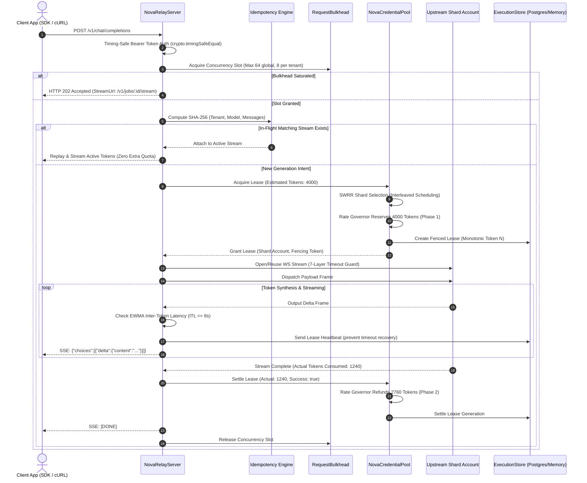

# Request Lifecycle & Substrate Dataflow

[Wiki Portal](../README.md) > [Architecture](./README.md) > Request Lifecycle

This document traces the complete end-to-end lifecycle of an inference request passing through NOVA, detailing each gate, validation check, cryptographic transformation, and token accounting step.

---

## High-Level Sequence Flow

---

## 9-Step Lifecycle Breakdown

### 1. Timing-Safe Credential Admission
When a request arrives at the Northbound gateway:
- The incoming `Authorization: Bearer <token>` is hashed with SHA-256 into a 32-byte digest.
- Padded constant-time equality is evaluated using `crypto.timingSafeEqual()` against configured active keys (`RELAY_API_KEYS`).
- Any failure returns `HTTP 401 Unauthorized` without revealing key length or formatting diagnostics.

### 2. Concurrency Bulkhead Gate
The `RequestBulkhead` enforces two boundaries:
- **Global Concurrency Ceiling:** Defaults to 64 simultaneous in-flight inference operations.
- **Tenant Concurrency Ceiling:** Defaults to 8 simultaneous in-flight operations per tenant ID (`x-nova-tenant` or bearer key hash).
- If the bulkhead is saturated, the request is smoothly decoupled into `BroccoliQueue` and returns `HTTP 202 Accepted` with a decoupled stream URL.

### 3. Prompt Hashing & Idempotency Collapsing
The request payload (model, temperature, messages, tool definitions) is canonicalized and hashed via SHA-256. If a matching in-flight stream is already generating tokens for the same tenant, the caller attaches to the existing stream, preventing duplicate provider billing during network retries.

### 4. SWRR Shard Lease Acquisition
The `NovaCredentialPool` evaluates all active, non-quarantined shards using Smooth Weighted Round Robin. Candidate weights are adjusted continuously, ensuring interleaved dispatch without quota bursts.

### 5. Two-Phase Token Reservation
Before opening an upstream network connection, the shard's rate governor reserves an estimated token envelope (prompt tokens + requested `max_tokens`). Both RPM (Requests Per Minute) and TPM (Tokens Per Minute) are deducted atomically.

### 6. Upstream WebSocket Connection & 7-Layer Timeouts
The gateway opens or multiplexes a secure WebSocket to the selected shard endpoint. All seven timeout layers are armed:
- **Layer 0:** Handshake budget (15s).
- **Layer 1:** Model-adaptive TTFT (60s baseline, $120\text{s}$ for reasoning models).
- **Layer 2:** ITL gap detection (8s inter-token ceiling).
- **Layer 5:** Dead-peer pings and Cloudflare `: ping\n\n` comments.

### 7. Token Streaming with Lease Heartbeats
As output delta frames arrive:
- Tokens are streamed to the client via Server-Sent Events (SSE).
- The gateway calls `context.heartbeat()` to extend the distributed execution lease in PostgreSQL/BroccoliDB, ensuring long-running reasoning jobs are not prematurely recovered by idle workers.

### 8. Actual Usage Settlement & Token Refund
When the provider emits its final usage frame (or stream terminates):
- Actual prompt tokens and completion tokens are extracted.
- Unconsumed reserved tokens (e.g. reserved 4,000, consumed 1,240 $\rightarrow$ refund 2,760) are credited back into the shard's token bucket immediately.

### 9. Fenced Lease Finalization
The monotonic fencing token is validated against the database generation. The execution record transitions to `settled`, and the bulkhead concurrency slot is returned to the pool.
