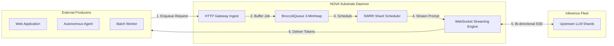

# Standalone Substrate Architecture & Process Topology

This document provides the definitive architectural specification for NOVA's **standalone daemon substrate model**, contrasting it with anti-pattern in-process embedding and illustrating its role as an autonomous producer and consumer of generative inference workloads.

---

## Table of Contents

- [Architectural Positioning: Substrate vs. Product Layer](#architectural-positioning-substrate-vs-product-layer)
- [Process Boundary & Network Topology](#process-boundary--network-topology)
- [Producer & Consumer Operational Lifecycle](#producer--consumer-operational-lifecycle)
- [Comparative Architectural Analysis: Standalone Daemon vs. Embedded Library](#comparative-architectural-analysis-standalone-daemon-vs-embedded-library)
- [Standard Production Deployment Topologies](#standard-production-deployment-topologies)
  - [Pattern 1: Kubernetes Pod Sidecar (Localhost)](#pattern-1-kubernetes-pod-sidecar-localhost)
  - [Pattern 2: Dedicated Central Gateway Cluster](#pattern-2-dedicated-central-gateway-cluster)
  - [Pattern 3: Local Development Daemon](#pattern-3-local-development-daemon)
- [Architectural Invariants & Safeguards](#architectural-invariants--safeguards)

---

## Architectural Positioning: Substrate vs. Product Layer

In modern software systems, a fundamental distinction exists between **Product Layers** and **Infrastructure Substrates**:

```
┌─────────────────────────────────────────────────────────────────────────────┐
│                              PRODUCT LAYER                                  │
│  • User Authentication (OAuth, Passwords, Sessions)                        │
│  • Business Rules, Pricing Tiers, Stripe Billing                            │
│  • Application UX, Responsive Web Pages, Mobile Clients                     │
│  • Domain-Specific Relational Data & User Chat Histories                    │
└──────────────────────────────────────┬──────────────────────────────────────┘
                                       │ Standard Wire Calls (HTTP / SSE)
                                       │ (OpenAI-Compatible Wire Format)
                                       ▼
┌─────────────────────────────────────────────────────────────────────────────┐
│                        NOVA INFRASTRUCTURE SUBSTRATE                        │
│  • Autonomous Process / Container                                           │
│  • Multi-Tenant Rate Governance & SWRR Shard Credential Pooling             │
│  • In-Process 3-MinHeap Priority Queuing (BroccoliQueue)                    │
│  • Hardware-Grade AES-256-GCM Vault & Privacy Firewall                      │
│  • Distilled PostgreSQL Job Checkpointing & Monotonic Fencing               │
└─────────────────────────────────────────────────────────────────────────────┘
```

NOVA is intentionally engineered to occupy the **Infrastructure Substrate** tier. It is designed to be operated, scaled, and secured as an independent network daemon—akin to Envoy Proxy, NGINX, or Redis—rather than an internal product module.

---

## Process Boundary & Network Topology

NOVA enforces an explicit process boundary between application logic and inference infrastructure:

```
┌───────────────────────────────────────────────┐
│              PRODUCT APPLICATION              │
│                 (Process A)                   │
│                                               │
│  • Next.js / Express / Python FastAPI         │
│  • Client SDK: NovaClient / OpenAI Python     │
└───────────────────────┬───────────────────────┘
                        │ Network Socket
                        │ (Unix Domain Socket / TCP Port 3001)
                        ▼
┌───────────────────────────────────────────────┐
│               NOVA RELAY DAEMON               │
│                 (Process B)                   │
│                                               │
│  • Dedicated Node.js Runtime                  │
│  • Bounded Heap Bulkheads (e.g. 512MB)        │
│  • Isolated Cryptographic Master Key          │
│  • Native MinHeap Queue Engine                │
└───────────────────────┬───────────────────────┘
                        │ Outbound TLS WebSockets
                        ▼
┌───────────────────────────────────────────────┐
│          UPSTREAM PROVIDER ENDPOINTS          │
│          (OpenAI / Custom Shards)             │
└───────────────────────────────────────────────┘
```

### Guarantees of the Process Boundary:
1. **Memory Isolation:** Memory allocation spikes during high-concurrency token buffering are contained strictly within Process B. The product application's memory pool remains pristine.
2. **Crash Containment:** Should an unexpected network exception or out-of-memory condition terminate Process A, active background queue jobs in Process B remain healthy. Conversely, a crash in Process B is isolated and immediately restarted by process supervisors (Systemd or Kubernetes Kubelet).
3. **Privilege Separation:** Process A has zero access to Process B's memory space, shielding `$GALX_VAULT_KEY` and raw shard tokens from potential application-layer Remote Code Execution (RCE) or prototype pollution vulnerabilities.

---

## Producer & Consumer Operational Lifecycle

NOVA serves simultaneously as a **work consumer** and a **work producer**:



### 1. Ingestion Phase (Consuming Work)
External producer applications dispatch inference payloads using standard OpenAI-compatible requests:
- **Synchronous Streaming:** Client opens an HTTP request to `POST /v1/chat/completions` with `"stream": true`.
- **Asynchronous Decoupling:** Under burst load, NOVA accepts the job (`HTTP 202 Accepted`), returning a tracking handle (`job_id`).

### 2. Autonomous Execution Phase
NOVA acts as an independent consumer:
- `BroccoliQueue` workers claim jobs according to priority and execution deadlines.
- The `NovaCredentialPool` leases optimal shard accounts via Smooth Weighted Round Robin (SWRR).
- Rate limits are calculated via Continuous Token Buckets with microsecond precision.

### 3. Egress Phase (Producing Results)
NOVA streams sanitized tokens to the caller over Server-Sent Events (SSE) or persists execution states to PostgreSQL for polling retrieval.

---

## Comparative Architectural Analysis: Standalone Daemon vs. Embedded Library

| Operational Attribute | ❌ Embedded Library Anti-Pattern | ✅ Standalone Daemon Substrate |
| :--- | :--- | :--- |
| **Process Model** | Runs inside host application process. | Runs in a dedicated, isolated OS process or container. |
| **Event Loop Contention** | High: JSON serialization and streaming compete with web views. | Zero: Dedicated event loop exclusively handling network I/O. |
| **Credential Security** | Weak: Secrets reside in product application memory space. | High: Vault master key isolated in daemon environment. |
| **Fault Isolation** | None: Crash in product terminates all active inference streams. | Complete: Host process crashes do not kill the inference daemon. |
| **Autoscaling Strategy** | Coupled: Must scale web apps to handle inference queue load. | Independent: Scale relay instances based on WebSocket concurrency. |
| **Code Maintainability** | Poor: Product features slowly creep into queue algorithms. | Pristine: Strict adherence to core proxy and scheduling invariants. |

---

## Standard Production Deployment Topologies

### Pattern 1: Kubernetes Pod Sidecar (Localhost)
In microservices architectures, deploy NOVA as a sidecar container sharing the Pod's network namespace:
- Application container addresses NOVA at `http://127.0.0.1:3001`.
- Near-zero network latency ($< 0.1\text{ ms}$).
- Complete process and resource isolation via cgroups.

### Pattern 2: Dedicated Central Gateway Cluster
For multi-tenant organizations, deploy NOVA as an autoscaled cluster behind an internal load balancer:
- Highly available ingress pool managed via Kubernetes Horizontal Pod Autoscaler (HPA).
- Independent scaling driven by `nova_active_websocket_connections` Prometheus metrics.

### Pattern 3: Local Development Daemon
For local engineering, developers launch NOVA as a background process:
```bash
npx tsx bin/nova.ts relay --port 3001 --api-key sk-local-dev
```
All local applications, scripts, and tests interact with the gateway via port `3001` without local code imports.

---

## Architectural Invariants & Safeguards

To prevent future scope creep, maintainers must verify:
1. **Zero UI Assets:** No React components, HTML templates, or CSS files exist in core repository paths.
2. **Zero In-Process Exits:** The relay gateway is started exclusively through CLI entrypoints (`bin/nova.ts`) or container entrypoints (`npm run start:relay`).
3. **Clean Wire Decoupling:** All interactions with NOVA take place over HTTP/WebSocket sockets, never direct in-process method invocations across application boundaries.
