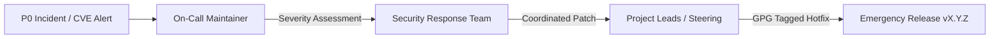

# Maintainer Operations & Engineering Standards Portal

Welcome to the **NOVA Maintainer Operations Portal**. This directory houses the authoritative, binding operational procedures for repository maintainers, release engineers, and security responders.

---

## Table of Contents

- [Maintainer Mission & Operational Charter](#maintainer-mission--operational-charter)
- [Operational Guides Directory](#operational-guides-directory)
- [Maintainer Weekly On-Call Rotation](#maintainer-weekly-on-call-rotation)
- [Strict Maintainer Quality Gates](#strict-maintainer-quality-gates)
- [Emergency Escalation Matrix](#emergency-escalation-matrix)

---

## Maintainer Mission & Operational Charter

As a maintainer of NOVA, your core mandate is to safeguard the **stability, security, performance, and deterministic behavior** of the inference relay gateway. We prioritize engineering correctness and architectural purity over rushed delivery.

Maintainers are expected to:
1. **Act Defensively:** Assume network failures, upstream WebSocket hangs, database latency spikes, and untrusted client inputs.
2. **Uphold Invariants:** Ensure zero external dependencies creep into core paths (no Redis, no BullMQ, no UI templates).
3. **Guard Maintainability:** Reject pull requests that lack adequate unit tests, type safety, or architectural documentation.
4. **Foster Community Trust:** Maintain empathetic, prompt, and transparent communication across all issues and pull requests.

---

## Operational Guides Directory

The following comprehensive playbooks govern daily repository operations:

| Playbook | Summary | Primary Audience |
| :--- | :--- | :--- |
| 🛡️ **[Anti-Scope-Creep & Non-Embedding Policy](./anti-scope-creep-policy.md)** | Mandatory policy prohibiting in-process embedding into external products, defining the standalone daemon model and scope boundaries. | Core Maintainers, Reviewers, Steering |
| 🚀 **[Release Engineering Guide](./release-engineering.md)** | Step-by-step SemVer 2.0 release procedure, GPG signing, SLSA Level 3 provenance, multi-arch container builds, and emergency rollback protocols. | Release Engineers, Steering Committee |
| 🛡️ **[Code Review & Merging Policy](./code-review-and-merging.md)** | Review checklists, invariant validation, CI gate requirements, Conventional Commit rules, and squash-and-merge enforcement. | Core Maintainers, Reviewers |
| 🔒 **[Security Vulnerability Handling](./security-vulnerability-handling.md)** | Incident intake via GitHub PVR, CVSS v3.1 scoring, private advisories (GHSA), 14-day embargoes, CVE reservations, and patch backporting. | Security Response Team (SRT) |
| 🩺 **[Triaging & Issue Governance](./triaging-and-support.md)** | Issue lifecycle state machine, priority matrix (P0-P4), minimal reproduction verification, and stale bot automation. | Triagers, Reviewers |
| 🗄️ **[Database Migration Policy](./database-migration-policy.md)** | Zero-downtime PostgreSQL schema evolution for `db/schema.sql`, expand-contract pattern, safe locking, and rollback runbooks. | Database Stewards, Core Maintainers |
| 👥 **[Onboarding & Offboarding Runbook](./onboarding-and-offboarding.md)** | Maintainer career ladder, hardware 2FA enforcement, GPG key registration, permission matrices, and emeritus offboarding. | Steering Committee, Mentors |
| 🏛️ **[Architecture Governance](./architecture-governance.md)** | Architectural Decision Record (ADR) lifecycle, anti-dependency creep policies, and subsystem boundary enforcement. | Architects, Core Maintainers |
| 📑 **[Request for Comments (RFC) Process](./rfc-process.md)** | Formal RFC process for proposing non-trivial architectural, protocol wire, or scheduling algorithm evolutions. | Contributors, Maintainers |

---


## Maintainer Weekly On-Call Rotation

NOVA maintains a rolling **Weekly Maintainer On-Call** rotation to ensure predictable SLAs for community submissions and incident responses:

### Weekly On-Call Responsibilities
- **Daily Issue Triage:** Review incoming issues at 09:00 UTC and 17:00 UTC. Apply priority tags (`P0` through `P4`) and verify reproductions.
- **PR Initial Review:** Ensure all newly opened PRs receive actionable feedback within 48 hours.
- **CI Failure Investigation:** Investigate broken builds on `main` immediately upon notification.
- **Security Triage:** Monitor `security@nova-relay.internal` and GitHub Private Vulnerability Reporting for critical alerts.

### Handover Protocol
Every Monday at 10:00 UTC, the outgoing on-call maintainer conducts a 15-minute asynchronous handover with the incoming on-call:
- Review unmerged P0/P1 PRs.
- Highlight ongoing upstream provider anomalies or flaky test reports.
- Confirm credential rotation status.

---

## Strict Maintainer Quality Gates

Before merging ANY change into `main`, verify all three automated gates pass cleanly:

```bash
# 1. Zero stale information and valid links across all markdown docs
npm run lint:docs

# 2. Strict zero-error TypeScript typechecking
npm run typecheck

# 3. 100% passing test suite across native unit and integration tests
npm test
```

> [!CAUTION]
> Bypassing CI checks via administrative branch override is strictly forbidden under normal operating conditions. In an emergency P0 production restore scenario, an administrative merge requires a subsequent post-incident disclosure ticket opened within 24 hours.

---

## Emergency Escalation Matrix

If a critical incident or security vulnerability arises, maintainers must follow this escalation path:



- **P0 Outage / Data Loss:** Ping `#nova-ops-urgent` on internal communications or page the Steering Committee directly.
- **Active Exploit:** File a private GitHub Security Advisory immediately. Do not disclose details on public Slack/Discord/Issues.
- **Credential Compromise:** Follow the [Emergency Credential Revocation Protocol](./onboarding-and-offboarding.md#emergency-credential-revocation-protocol).
