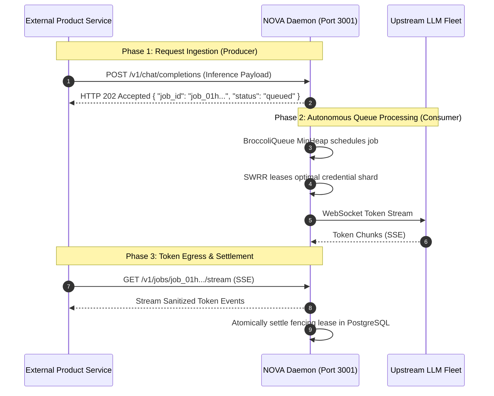

# Anti-Scope-Creep & Non-Embedding Policy

This document establishes the mandatory architectural and governance policy regarding **scope boundaries**, the **prohibition of in-process embedding**, and the protection of NOVA as an **independent, out-of-process inference relay and queue substrate**.

---

## Table of Contents

- [The Substrate Mandate](#the-substrate-mandate)
- [Why NOVA Must Never Be Embedded in Another Product](#why-nova-must-never-be-embedded-in-another-product)
- [The Scope Boundary Matrix](#the-scope-boundary-matrix)
  - [What is Strictly IN-SCOPE](#what-is-strictly-in-scope)
  - [What is Strictly OUT-OF-SCOPE (Prohibited)](#what-is-strictly-out-of-scope-prohibited)
- [Canonical Process Topology: Producer & Consumer](#canonical-process-topology-producer--consumer)
- [Maintainer Review & Rejection Protocol](#maintainer-review--rejection-protocol)
  - [Evaluation Checklist](#evaluation-checklist)
  - [Standard Rejection Template for Scope Creep](#standard-rejection-template-for-scope-creep)
- [Approved Integration Patterns](#approved-integration-patterns)

---

## The Substrate Mandate

NOVA is engineered and maintained exclusively as an **autonomous infrastructure substrate**—an independent process, container, or daemon that serves as a high-throughput producer and consumer of generative AI inference requests.

**NOVA IS NOT A PRODUCT LAYER.** It is not a user-facing SaaS application, an in-app widget library, an embedded utility for client applications, or a frontend web server. 

Any attempt to blur this boundary or embed NOVA directly into another product's runtime violates our core architecture.

---

## Why NOVA Must Never Be Embedded in Another Product

Allowing NOVA to be imported or bundled into host product applications (such as a Next.js web application, an Electron desktop shell, or an application-layer backend monolith) introduces catastrophic systems vulnerabilities:

```
❌ ANTI-PATTERN: In-Process Embedding
┌─────────────────────────────────────────────────────────────┐
│                 HOST PRODUCT APPLICATION                    │
│                                                             │
│   ┌─────────────────────┐       ┌──────────────────────┐    │
│   │ Product UI / Logic  │◄─────►│ Embedded NOVA Relay  │    │  <-- Memory Contention,
│   │ (Next.js / Express) │       │ (MinHeaps + Crypto)  │    │      Shared Event Loop,
│   └─────────────────────┘       └──────────────────────┘    │      Blast Radius Coupling
└─────────────────────────────────────────────────────────────┘

✅ CANONICAL PATTERN: Out-of-Process Standalone Daemon
┌─────────────────────────────────┐        ┌──────────────────────────────────┐
│    HOST PRODUCT APPLICATION     │        │       NOVA DAEMON SUBSTRATE      │
│                                 │  Wire  │                                  │
│  • Web App / Microservice       │ Protocol • Autonomous Container / Process │
│  • Generates inference requests ├───────►│ • MinHeap Queues + SWRR Pools    │
│  • Consumes token streams       │◄───────┤ • Isolated AES-256 Vault         │
│                                 │ (HTTP) │ • Dedicated Memory Bulkhead      │
└─────────────────────────────────┘        └──────────────────────────────────┘
```

1. **The Shared Event Loop Stall (Inter-Token Latency Degradation):**
   Node.js relies on a single-threaded event loop for JavaScript task execution and network I/O polling. High-velocity token streaming over WebSockets requires microsecond-level loop dispatching. If the relay shares an event loop with a product's server-rendered views, heavy GraphQL resolvers, or synchronous JSON transformations, event loop lag directly causes Inter-Token Latency (ITL) stalls, triggering client timeouts and ruining generation smoothness.
2. **Cascading Blast Radius & Process Fatality:**
   An unhandled exception, fatal memory allocation failure (OOM), or unhandled promise rejection in the product layer terminates the host OS process. In an embedded architecture, this crash destroys active WebSocket streams, drops pending in-flight queue jobs, and corrupts in-progress credential leases across all tenants. Running NOVA out-of-process ensures zero blast radius contamination.
3. **Cryptographic Key Bleed & Supply-Chain Exposure:**
   The NOVA vault utilizes AES-256-GCM envelope encryption with sensitive master keys (`$GALX_VAULT_KEY`) and decrypted upstream shard tokens. Embedding NOVA in a product application exposes these secrets to product-level logging, crash reporting services (e.g. Sentry), and untrusted third-party npm dependencies within the product's dependency tree.
4. **Autoscaling Asymmetry & Resource Inefficiency:**
   Product applications scale dynamically based on HTTP page impressions, user sessions, or business transactions. Inference relay daemons scale based on concurrent persistent WebSockets, open socket file descriptors, and queue buffer depths. Coupling them forces infrastructure operators to over-provision expensive product instances rather than scaling lean, high-concurrency relay containers.
5. **Architectural Erosion & Direct State Bypassing:**
   Embedding creates an irresistible temptation for product developers to directly mutate internal MinHeap arrays, bypass SWRR balance tables, or skip monotonic fencing lease validation in PostgreSQL. Operating strictly over network sockets enforces clean, immutable protocol boundaries.

---


## The Scope Boundary Matrix

Maintainers must enforce strict adherence to the scope boundaries below:

### What is Strictly IN-SCOPE
Features and architectural capabilities that directly serve the core routing, queuing, rate-governance, and credential pooling mission:
- High-throughput OpenAI-compatible HTTP and WebSocket proxying with $< 0.4\text{ ms}$ overhead.
- Smooth Weighted Round Robin (SWRR) credential scheduling across heterogeneous shard fleets.
- Two-phase continuous token-bucket rate governance with unconsumed token refunds.
- Native 3-MinHeap priority queues (BroccoliQueue) with crash-resilient WAL checkpointing.
- Distilled, self-contained PostgreSQL relational execution store with monotonic fencing tokens.
- Zero-leak privacy firewalls stripping internal metadata and masking upstream failure diagnostics.
- Prometheus telemetry tracking real-time TTFT and Inter-Token Latency (ITL) percentiles.

### What is Strictly OUT-OF-SCOPE (Prohibited)
Features and pull requests that introduce application-level product features or attempt in-process embedding:
- Embedded in-app UI components, HTML templates, CSS styles, or frontend framework bundles.
- User account registration, password hashing, consumer social logins, or end-user session state.
- Billing, subscription plans, credit card checkout gateways (e.g. Stripe, PayPal), or consumer invoicing.
- Application-level chat history databases, CRM records, or long-term conversation storage.
- In-process module exports or packaging designed to embed NOVA directly inside a host product app.

### Scope Summary Table

| Feature Domain | Status | Architectural Rationale |

| :--- | :---: | :--- |
| **High-Throughput HTTP / WS Proxying** | **IN-SCOPE** | Core mission: routing inferences with minimal latency overhead ($< 0.4\text{ ms}$). |
| **Smooth Weighted Round Robin (SWRR)** | **IN-SCOPE** | Core mission: balancing load across upstream provider credentials. |
| **Continuous Token-Bucket Rate Governance** | **IN-SCOPE** | Core mission: protecting upstream accounts from quota exhaustion. |
| **Native 3-MinHeap Priority Queuing** | **IN-SCOPE** | Core mission: managing queue prioritization without external Redis dependencies. |
| **Distilled PostgreSQL Execution Store** | **IN-SCOPE** | Core mission: idempotent atomic job persistence and lease settlement. |
| **Sanitized Egress Privacy Firewall** | **IN-SCOPE** | Core mission: masking internal tokens, shard IDs, and vendor errors. |
| **Prometheus Telemetry & ITL Percentiles** | **IN-SCOPE** | Core mission: observability into streaming latency and error budgets. |
| **Embedded In-App UI Components (React/Vue/CSS)** | ❌ **PROHIBITED** | NOVA is strictly headless; user interfaces belong exclusively in client apps. |
| **User Account & Password Authentication** | ❌ **PROHIBITED** | NOVA authenticates API keys via constant-time hashes; user accounts belong in product IAM. |
| **Billing, Subscriptions & Payment Checkouts** | ❌ **PROHIBITED** | Commercial monetization logic belongs in external product billing layers. |
| **Application-Level Chat History / CRM Storage** | ❌ **PROHIBITED** | NOVA persists execution checkpoints; chat history storage belongs in product databases. |
| **In-Process Module Embedding in Foreign Apps** | ❌ **PROHIBITED** | NOVA must be deployed as a distinct, standalone network service. |

---

## Canonical Process Topology: Producer & Consumer

NOVA operates as an autonomous **producer and consumer substrate**:



1. **Ingestion (Producer Role):** External products produce work items by dispatching HTTP/WebSocket requests to NOVA.
2. **Autonomous Scheduling & Execution:** NOVA buffers, prioritizes, rate-limits, and executes requests independently of the caller's process state.
3. **Delivery (Consumer Role):** NOVA streams results back to the caller or stores finalized checkpoints for decoupled retrieval.

---

## Maintainer Review & Rejection Protocol

### Evaluation Checklist
During pull request review, maintainers must verify:
- [ ] Does this PR attempt to expose internal engine objects to allow in-process embedding in foreign applications? (If yes $\rightarrow$ **Reject**)
- [ ] Does this PR introduce UI markup, CSS files, client-side templates, or browser bundler configurations? (If yes $\rightarrow$ **Reject**)
- [ ] Does this PR add product-specific user management, payment gateways, or end-user session tracking? (If yes $\rightarrow$ **Reject**)
- [ ] Does this change preserve the standalone daemon model? (If no $\rightarrow$ **Reject**)

### Standard Rejection Template for Scope Creep

When closing a PR or issue that violates this policy, use the following template:

```markdown
Hi @contributor, thank you for your submission and interest in improving NOVA!

Upon review, this proposed change introduces [in-process embedding / user-facing UI / product-level business logic], which falls outside the scope of NOVA's architecture.

As documented in our [Anti-Scope-Creep Policy](file:///Users/bozoegg/Downloads/nova/docs/maintainers/anti-scope-creep-policy.md) and [ADR-0007](file:///Users/bozoegg/Downloads/nova/docs/adrs/ADR-0007-standalone-daemon-substrate-non-embedding.md):
- NOVA is engineered strictly as an **autonomous, out-of-process infrastructure substrate**.
- It is designed to run as an independent daemon/service communicating over standard network wire protocols (`/v1/*`), not as an embedded library inside consumer product applications.
- Product-layer features (such as user accounts, UI components, and application-specific databases) must reside in external product services that interface with NOVA via our standard API or SDKs.

Because of this architectural invariant, we cannot merge this pull request. We welcome contributions focused on our core relay, queuing, rate-governance, and telemetry capabilities!
```

---

## Approved Integration Patterns

Downstream teams wishing to integrate NOVA into their architectures should use the following approved patterns:

1. **Containerized Sidecar (Kubernetes / ECS):** Deploy `ghcr.io/cardsorting/nova:latest` in the same pod or task definition as your application container, communicating over `http://127.0.0.1:3001/v1`.
2. **Centralized Inference Cluster:** Run a dedicated cluster of NOVA daemons behind a load balancer (e.g. AWS ALB, Traefik, NGINX) accessible to all backend microservices.
3. **Official Client SDKs:** Use [NovaClient](file:///Users/bozoegg/Downloads/nova/docs/sdks/typescript-nova-client.md) in TypeScript, official [OpenAI Python SDK](file:///Users/bozoegg/Downloads/nova/docs/sdks/python-openai.md), or [LangChain](file:///Users/bozoegg/Downloads/nova/docs/sdks/langchain-integration.md) pointed to your NOVA gateway URL.
