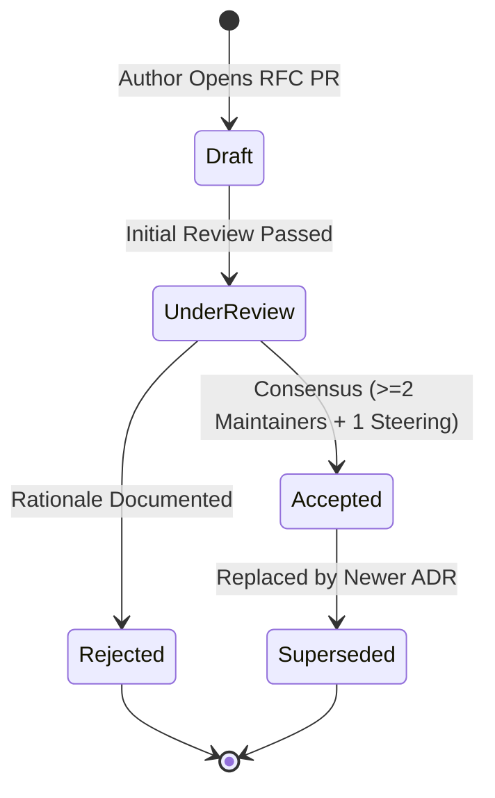

# Architecture Governance & Anti-Dependency Creep Policy

This document defines the architectural governance standards, the Architecture Decision Record (ADR) lifecycle, subsystem boundary guarantees, and the strict anti-dependency creep policies for **NOVA**.

---

## Table of Contents

- [Architectural Principles & Mandate](#architectural-principles--mandate)
- [Architecture Decision Record (ADR) Lifecycle](#architecture-decision-record-adr-lifecycle)
  - [Lifecycle States](#lifecycle-states)
  - [When is an ADR Mandatory?](#when-is-an-adr-mandatory)
  - [Standard ADR Format Requirements](#standard-adr-format-requirements)
- [Strict Anti-Dependency Creep Policy](#strict-anti-dependency-creep-policy)
  - [Prohibited Runtime Dependencies](#prohibited-runtime-dependencies)
  - [Third-Party Dependency Evaluation Checklist](#third-party-dependency-evaluation-checklist)
- [Subsystem Boundary Isolation & Invariants](#subsystem-boundary-isolation--invariants)
  - [1. Headless Execution Invariant](#1-headless-execution-invariant)
  - [2. Hermetic Workspace Boundary](#2-hermetic-workspace-boundary)
  - [3. Zero-Leak Privacy Firewall](#3-zero-leak-privacy-firewall)
  - [4. Relational Persistence Decoupling](#4-relational-persistence-decoupling)
- [Enforcement via Automated CI Gates](#enforcement-via-automated-ci-gates)

---

## Architectural Principles & Mandate

NOVA is engineered as a high-velocity, deterministic, autonomous inference relay gateway. Because NOVA operates on the critical path of real-time LLM token streams, its codebase must resist architectural erosion and dependency bloat.

Maintainers must prioritize:
1. **Minimal Surface Area:** Every added dependency represents a supply-chain attack vector, potential memory leak, and maintenance burden.
2. **Defensive Isolation:** Failure in one subsystem (e.g. database query latency) must never cascade into catastrophic failure in streaming WebSocket relays.
3. **Deterministic Memory Footprint:** Bounded queues, streaming backpressure, and zero heap retention.

---

## Architecture Decision Record (ADR) Lifecycle

Every significant architectural pivot, data structure introduction, or protocol wire change must be memorialized in an Architecture Decision Record (ADR) under [docs/adrs/](file:///Users/bozoegg/Downloads/nova/docs/adrs).

### Lifecycle States



- **Draft:** Author submits a pull request introducing a new document formatted as `docs/adrs/ADR-XXXX-<title>.md`.
- **Under Review:** PR enters a mandatory 7-day review window for maintainer and community input.
- **Accepted:** Consensus is reached. The ADR is merged and becomes binding policy.
- **Rejected:** If the proposal violates core invariants or lacks sufficient justification, it is documented as Rejected with technical reasoning.
- **Superseded:** If future requirements render an accepted ADR obsolete, a new ADR is authored that explicitly supersedes the predecessor.

### When is an ADR Mandatory?
An ADR is strictly required before merging any PR that:
1. Introduces a new external runtime npm dependency.
2. Alters public HTTP or WebSocket protocol wire specifications (`/v1/*`).
3. Modifies the relational schema or stored procedures in [db/schema.sql](file:///Users/bozoegg/Downloads/nova/db/schema.sql).
4. Re-architects scheduling algorithms (e.g. SWRR, MinHeap priority queue, continuous token buckets).
5. Alters cryptographic algorithms or key management workflows.

### Standard ADR Format Requirements
Every ADR must include the following four mandatory sections (enforced by `npm run lint:docs`):
- `## Status` (Proposed, Accepted, Rejected, or Superseded)
- `## Context` (The underlying technical challenge or design motivation)
- `## Decision` (The chosen architectural strategy, detailed specifications, and diagrams)
- `## Consequences` (Trade-offs, positive benefits, negative burdens, and operational impact)

---

## Strict Anti-Dependency Creep Policy

The vast majority of systems failures stem from unvetted third-party dependencies. NOVA enforces an aggressive anti-dependency posture.

### Prohibited Runtime Dependencies

| Prohibited Category | Disallowed Libraries | Architectural Rationale |
| :--- | :--- | :--- |
| **External Queue Engines** | Redis, BullMQ, RabbitMQ, Kafka | BroccoliQueue provides native in-process 3-MinHeap priority queues, eliminating external infrastructure dependencies. |
| **Heavy ORM Frameworks** | Prisma, TypeORM, Sequelize | Heavy ORMs introduce substantial memory bloat and opaque query plans. NOVA relies on distilled, transparent PostgreSQL primitives. |
| **Client UI Frameworks in Backend** | React, Vue, Svelte, TailwindCSS | Core inference relays and queues must remain 100% headless. UI components belong in external frontend clients. |
| **Heavy Utility Bundles** | Lodash, Underscore, Moment.js | Native Node.js 20+ features (`Array.prototype.*`, `Temporal`, `node:crypto`) provide superior performance with zero bundle overhead. |

### Third-Party Dependency Evaluation Checklist
Before proposing any new dependency, the author and reviewing maintainers must confirm:
- [ ] **Native Feasibility:** Can this functionality be implemented natively in `< 200` lines of clean, tested TypeScript? If yes, author it natively.
- [ ] **License Compatibility:** Is the license permissive (MIT, Apache 2.0, or BSD)? Copyleft licenses (GPL, AGPL) are prohibited.
- [ ] **Zero Native C++ Addons:** Does the package require `node-gyp` or native platform compilation? Pure JavaScript/TypeScript is required for universal container portability.
- [ ] **Supply Chain Health:** Does the package have high maintenance velocity, zero unpatched CVEs, and provenance verification?

---

## Subsystem Boundary Isolation & Invariants

The NOVA architecture is segregated into discrete, decoupled domains:

```
┌─────────────────────────────────────────────────────────────┐
│                       NOVA CORE ROOT                        │
├─────────────────┬─────────────────┬─────────────────────────┤
│    src/relay    │    src/queue    │        src/pool         │
│  HTTP Gateway   │   BroccoliDB    │   SWRR Account Leases   │
│  WebSocket Wire │  3-MinHeap Hub  │   Rate Governance       │
├─────────────────┴─────────────────┴─────────────────────────┤
│                           src/db                            │
│           Distilled PostgreSQL Execution Store              │
└─────────────────────────────────────────────────────────────┘
```

### 1. Headless Execution Invariant
The queue and relay engines must function purely as headless background processes. No browser DOM globals (`window`, `document`, `HTMLElement`) may ever be referenced in core modules.

### 2. Hermetic Workspace Boundary
The repository must remain 100% self-contained. Any import referencing `../` that traverses outside the project root is strictly prohibited and fails build checks.

### 3. Zero-Leak Privacy Firewall
Public relay endpoints must isolate internal cluster topology from callers. Error handlers must route all upstream diagnostic dumps through `src/relay/private-failure.ts` to sanitize authorization tokens and provider shard IDs.

### 4. Relational Persistence Decoupling
Subsystems interact with database persistence via abstract interfaces (`IExecutionStore`). Storage implementations can be swapped between in-memory mock stores (`MemoryExecutionStore`) for testing and PostgreSQL (`PostgresExecutionStore`) for production without affecting business logic.

### 5. Standalone Daemon Substrate (Anti-Embedding Invariant)
NOVA must never be adapted, packaged, or imported as an in-process library inside consumer applications. Applications must communicate with NOVA strictly over network wire protocols (HTTP/WS). For comprehensive guidelines, consult the [Anti-Scope-Creep Policy](./anti-scope-creep-policy.md) and [ADR-0007](../adrs/ADR-0007-standalone-daemon-substrate-non-embedding.md).

---

## Enforcement via Automated CI Gates

Architectural boundaries are enforced automatically on every commit:
- `scripts/lint-docs.ts` verifies ADR structure, checks for stale dependencies, and flags missing documentation links.
- `tsc --noEmit` verifies strict type decoupling across all subsystems.
- `npm test` runs isolated unit tests asserting that components operate independently without cross-boundary state leaks.

