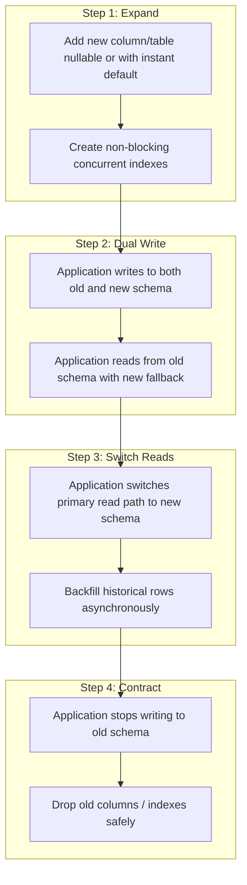

# Database Migration & Schema Evolution Policy

This document establishes the mandatory zero-downtime database migration rules, DDL safety constraints, and rollback procedures for altering NOVA's distilled PostgreSQL substrate in [db/schema.sql](file:///Users/bozoegg/Downloads/nova/db/schema.sql).

---

## Table of Contents

- [Substrate Invariants & Architecture](#substrate-invariants--architecture)
- [Zero-Downtime Schema Evolution: The Expand-Contract Pattern](#zero-downtime-schema-evolution-the-expand-contract-pattern)
  - [Phase 1: Expand (Additive Changes)](#phase-1-expand-additive-changes)
  - [Phase 2: Dual-Writing & Fallback Reading](#phase-2-dual-writing--fallback-reading)
  - [Phase 3: Primary Read Migration](#phase-3-primary-read-migration)
  - [Phase 4: Contract (Retirement & Cleanup)](#phase-4-contract-retirement--cleanup)
- [PostgreSQL DDL Safety Rules & Lock Management](#postgresql-ddl-safety-rules--lock-management)
  - [1. Lock Timeout Safeguards](#1-lock-timeout-safeguards)
  - [2. Non-Blocking Index Creation (`CONCURRENTLY`)](#2-non-blocking-index-creation-concurrently)
  - [3. Safe Column Additions](#3-safe-column-additions)
  - [4. Non-Blocking Constraint Validation](#4-non-blocking-constraint-validation)
- [Maintainer Schema Review Checklist](#maintainer-schema-review-checklist)
- [Verification & Automated Test Enforcement](#verification--automated-test-enforcement)
- [Emergency Rollback Runbook](#emergency-rollback-runbook)

---

## Substrate Invariants & Architecture

NOVA relies on a **distilled PostgreSQL substrate** optimized for high-throughput relational persistence and atomic job lease tracking.

All database modifications must observe these architectural invariants:
1. **Single Source of Truth:** Schema definitions live exclusively in [db/schema.sql](file:///Users/bozoegg/Downloads/nova/db/schema.sql) and development seed fixtures in [db/seed.sql](file:///Users/bozoegg/Downloads/nova/db/seed.sql).
2. **Zero Cloud Lock-In:** The database must remain 100% portable across standard PostgreSQL (versions 14, 15, and 16+). Proprietary cloud RPCs, custom extensions, or platform-specific triggers are prohibited.
3. **Idempotency by Design:** All migration scripts and DDL statements must be safely re-runnable (`CREATE TABLE IF NOT EXISTS`, `CREATE INDEX IF NOT EXISTS`).

---

## Zero-Downtime Schema Evolution: The Expand-Contract Pattern

Production clusters cannot be stopped for maintenance windows. All schema transformations must follow the **Expand-Contract (Parallel Run)** methodology across multiple coordinated deployments:



### Phase 1: Expand (Additive Changes)
- Introduce new columns as `NULL` or with constant defaults that support instant metadata updates (PostgreSQL 11+).
- Create supporting indexes concurrently without holding `ACCESS EXCLUSIVE` table locks.
- Existing application code continues running completely unaffected.

### Phase 2: Dual-Writing & Fallback Reading
- Deploy application code that writes to both old and new columns.
- The read path continues using the old column, with a fallback to the new column.
- Run an asynchronous background backfill worker to populate new columns for legacy rows in bounded batches.

### Phase 3: Primary Read Migration
- Switch the application read path to query the new column exclusively.
- Verify through Prometheus telemetry (`nova_db_query_duration_seconds`) that latency percentiles remain optimal.

### Phase 4: Contract (Retirement & Cleanup)
- Deprecate and remove code references writing to the old column.
- In a subsequent release, drop the obsolete column and associated legacy indexes.

---

## PostgreSQL DDL Safety Rules & Lock Management

Every migration script executed against production or reviewed in a PR must satisfy these strict safety requirements:

### 1. Lock Timeout Safeguards
Every migration session must explicitly set a strict `lock_timeout`. This prevents DDL statements waiting behind long-running queries from queueing up incoming traffic and exhausting the connection pool:

```sql
-- Mandatory preamble for all migration scripts
SET lock_timeout = '2s';
SET statement_timeout = '30s';
```

### 2. Non-Blocking Index Creation (`CONCURRENTLY`)
Standard `CREATE INDEX` acquires a `SHARE` lock that blocks all write transactions (`INSERT`, `UPDATE`, `DELETE`). Always use `CONCURRENTLY`:

```sql
-- CORRECT: Non-blocking index creation
CREATE INDEX CONCURRENTLY IF NOT EXISTS idx_jobs_status_priority 
ON scheduler_queue (status, priority DESC);

-- FORBIDDEN: Blocks all queue mutations
-- CREATE INDEX idx_jobs_status_priority ON scheduler_queue (status, priority DESC);
```

### 3. Safe Column Additions
- Never add a column with a volatile or non-deterministic default (e.g., `DEFAULT clock_timestamp()`) in a single blocking DDL statement, as this forces a table-wide row rewrite.
- Constant defaults (e.g., `DEFAULT 'active'` or `DEFAULT 0`) are metadata-only operations in PostgreSQL 11+ and execute instantaneously.

### 4. Non-Blocking Constraint Validation
When adding foreign keys or check constraints to tables with millions of rows:
1. Add the constraint as `NOT VALID` (acquires a quick lock and validates future rows only).
2. Validate the constraint in a separate transaction via `VALIDATE CONSTRAINT` (reads table without blocking writes).

```sql
ALTER TABLE scheduler_queue 
ADD CONSTRAINT fk_tenant_id FOREIGN KEY (tenant_id) 
REFERENCES tenants (id) NOT VALID;

ALTER TABLE scheduler_queue 
VALIDATE CONSTRAINT fk_tenant_id;
```

---

## Maintainer Schema Review Checklist

Maintainers reviewing database modifications must verify:
- [ ] Preamble includes `SET lock_timeout = '2s';`.
- [ ] All new indexes specify `CONCURRENTLY`.
- [ ] No table-rewrite operations on high-traffic tables (`scheduler_queue`, `relay_execution_logs`).
- [ ] Idempotent keywords used throughout (`IF NOT EXISTS`, `IF EXISTS`).
- [ ] `npm run db:migrate` executes cleanly against an empty database.
- [ ] Corresponding TypeScript interfaces in `src/db/` and stored procedure bindings are updated.
- [ ] An Architecture Decision Record (ADR) is linked if introducing new core entities.

---

## Verification & Automated Test Enforcement

NOVA verifies schema validity through continuous integration testing:

```bash
# 1. Execute schema parser and query validation tests
npx tsx --test tests/database.test.ts

# 2. Verify schema and seed files execute sequentially without errors
npm run db:migrate
npm run db:seed
```

The CI pipeline runs automated checks asserting that `db/schema.sql` compiles, contains zero deprecated Supabase functions, and produces zero orphaned references.

---

## Emergency Rollback Runbook

If a migration triggers unexpected table locks or query regressions in production:

1. **Abort Running DDL:**
   Identify and terminate blocking migration queries immediately:
   ```sql
   SELECT pg_cancel_backend(pid) 
   FROM pg_stat_activity 
   WHERE query LIKE '%ALTER TABLE%' AND state != 'idle';
   ```
2. **Revert Application Deployment:**
   Because all migrations follow the Expand-Contract pattern, rolling back the application container to the previous release is safe—the old binary is fully compatible with the expanded schema.
3. **Drop Concurrent Indexes if Invalid:**
   If a concurrent index creation fails, it leaves an `INVALID` index behind. Clean it up with:
   ```sql
   DROP INDEX CONCURRENTLY IF EXISTS idx_jobs_status_priority;
   ```
