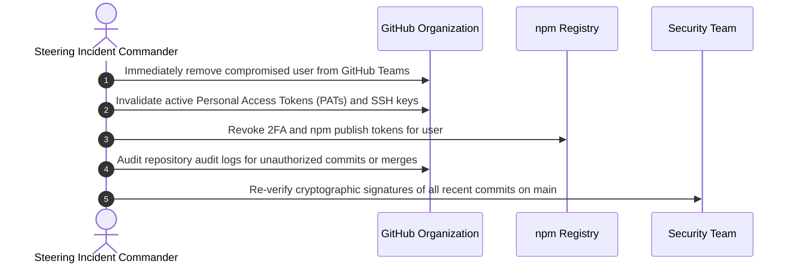

# Maintainer Onboarding, Offboarding & Security Access Runbook

This document defines the formal procedures for onboarding new reviewers and core maintainers, enforcing mandatory cryptographic credential standards, conducting mentorship pairing, and safely managing offboarding and emergency access revocation for **NOVA**.

---

## Table of Contents

- [The Maintainer Career Ladder](#the-maintainer-career-ladder)
- [Nomination & Election Workflow](#nomination--election-workflow)
- [Maintainer Security & Credential Standards](#maintainer-security--credential-standards)
  - [1. Hardware-Backed Two-Factor Authentication (FIDO2 / WebAuthn)](#1-hardware-backed-two-factor-authentication-fido2--webauthn)
  - [2. Cryptographic Commit & Tag Signing (GPG / SSH)](#2-cryptographic-commit--tag-signing-gpg--ssh)
  - [3. Dedicated Ed25519 SSH Keys](#3-dedicated-ed25519-ssh-keys)
- [Access Provisioning & Team Roles](#access-provisioning--team-roles)
- [90-Day Mentorship & Pairing Period](#90-day-mentorship--pairing-period)
- [Voluntary Emeritus Transition](#voluntary-emeritus-transition)
- [Inactivity Policy & Automatic Offboarding](#inactivity-policy--automatic-offboarding)
- [Emergency Credential Revocation Protocol](#emergency-credential-revocation-protocol)

---

## The Maintainer Career Ladder

Maintainership at NOVA is progressive and merit-based:

| Level | Role | Responsibilities | Repository Permissions |
| :--- | :--- | :--- | :--- |
| **Tier 1** | **Active Contributor** | Authors pull requests, participates in discussions, reports bugs with reproducible scripts. | Read / Fork access. |
| **Tier 2** | **Triager & Reviewer** | Triages issues, reproduces bug reports, reviews incoming PRs, verifies test runs. | Triage access on GitHub. |
| **Tier 3** | **Core Maintainer** | Full code review authority, approves PRs, merges to `main`, participates in release on-call. | Write access on GitHub, publish rights. |
| **Tier 4** | **Steering Committee** | Project architecture governance, trademark, release signing, security response leadership. | Admin access on GitHub, npm owner. |

---

## Nomination & Election Workflow

1. **Sponsorship:** An active Core Maintainer submits a nomination to the private maintainer discussion channel (`#nova-maintainers-private`) highlighting:
   - Summary of nominee's technical contributions ($\ge 5$ merged non-trivial PRs).
   - Evidence of high-quality, constructive code reviews ($\ge 10$ PR reviews).
   - Demonstrated mastery of NOVA's [Architectural Boundary Guarantees](file:///Users/bozoegg/Downloads/nova/CONTRIBUTING.md#architectural-boundary-guarantees).
2. **Review Window:** Maintainers have **7 calendar days** to review the nomination, ask questions, or raise concerns.
3. **Voting Quorum:** The election requires a **$2/3$ supermajority vote** of all active Core Maintainers.
4. **Acceptance:** Upon a successful vote, the sponsor invites the nominee and begins formal onboarding.

---

## Maintainer Security & Credential Standards

Maintainer accounts are high-value targets for software supply-chain attacks. All maintainers must adhere to the following mandatory security controls:

### 1. Hardware-Backed Two-Factor Authentication (FIDO2 / WebAuthn)
- Every maintainer MUST enforce hardware-backed 2FA (e.g. YubiKey or platform WebAuthn) on both **GitHub** and **npm**.
- SMS-based 2FA is strictly prohibited. Software TOTP (authenticator apps) is permitted only as a backup.

### 2. Cryptographic Commit & Tag Signing (GPG / SSH)
- All commits and release tags pushed to repository branches must be cryptographically signed.
- Unsigned commits are automatically rejected by branch protection rules.
- Maintainers must publish their public GPG key fingerprint in [MAINTAINERS.md](file:///Users/bozoegg/Downloads/nova/MAINTAINERS.md).

```bash
# Configure Git to automatically sign all commits
git config --global user.signingkey <YOUR_GPG_OR_SSH_KEY_ID>
git config --global commit.gpgsign true
git config --global tag.gpgsign true
```

### 3. Dedicated Ed25519 SSH Keys
- Maintainers must use modern `Ed25519` SSH keys with passphrases enabled. Legacy RSA keys with less than 4096 bits are disallowed.
```bash
ssh-keygen -t ed25519 -C "maintainer@nova-relay.internal"
```

---

## Access Provisioning & Team Roles

Once credentials are confirmed, access is granted strictly according to the Principle of Least Privilege:

| GitHub Team | Members | Granted Permissions |
| :--- | :--- | :--- |
| `@CardSorting/nova-reviewers` | Triagers & Reviewers | **Triage:** Label, close, and assign issues and PRs. |
| `@CardSorting/nova-maintainers` | Core Maintainers | **Write:** Code review approval, branch push, merge authority. |
| `@CardSorting/nova-srt` | Security Response Team | **Admin / Security:** Private vulnerability advisories and secret keys. |
| `@CardSorting/nova-steering` | Project Leads | **Admin:** Repository settings, webhooks, and team management. |

---

## 90-Day Mentorship & Pairing Period

Newly elevated Core Maintainers participate in a **90-Day Pairing Window**:
- **Assigned Mentor:** A senior Core Maintainer is assigned as a dedicated mentor.
- **Pair Reviewing:** During the first 30 days, the new maintainer co-reviews PRs with their mentor before approving or merging.
- **On-Call Shadowing:** The new maintainer shadows the weekly on-call maintainer for two full rotation cycles before taking primary rotation duty.
- **Graduation:** At day 90, the Steering Committee conducts a brief retrospective to confirm independent maintainership status.

---

## Voluntary Emeritus Transition

Maintainers who wish to step back due to personal commitments, career transitions, or other priorities are warmly thanked and transitioned to **Emeritus Maintainer**:
- The maintainer opens a PR updating their status in [MAINTAINERS.md](file:///Users/bozoegg/Downloads/nova/MAINTAINERS.md).
- Write and administrative permissions are gracefully relinquished.
- Emeritus maintainers retain lifetime acknowledgment and an open invitation to return.

---

## Inactivity Policy & Automatic Offboarding

To ensure active voting quorums and eliminate dormant attack vectors:
1. **6-Month Inactivity Trigger:** If a maintainer produces zero commits, reviews, or governance votes for 6 consecutive months, the Steering Committee initiates outreach.
2. **14-Day Notice:** If no response is received within 14 days, the maintainer is transitioned to Emeritus status.
3. **Revocation:** Repository write permissions and team memberships are removed.
4. **Reactivation:** An Emeritus maintainer may request reinstatement at any time, subject to a simple majority vote of active maintainers.

---

## Emergency Credential Revocation Protocol

In the event of a suspected account compromise, leaked API key, or urgent disciplinary action:



1. **Immediate Revocation:** The organization administrator removes the compromised account from all GitHub teams and repository collaborator lists within 15 minutes of detection.
2. **Token Invalidation:** Revoke all npm access tokens, deploy keys, and service secrets associated with the maintainer.
3. **Audit Log Inspection:** Inspect the GitHub organization audit log and recent git commit history for unauthorized commits, branch deletions, or release modifications.
4. **Re-verification:** If any commits were authored during the suspect window, audit them line-by-line and revert immediately if tampering is discovered.
