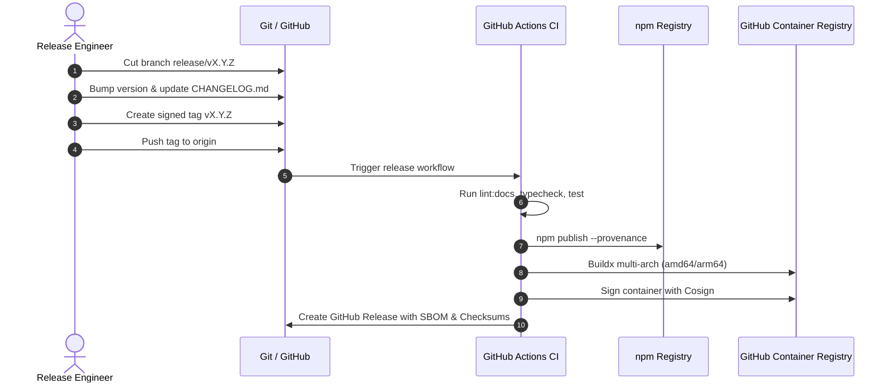

# Release Engineering & Deployment Protocol

This document defines the strict, repeatable release engineering process for **NOVA**. All official releases, container images, and npm packages must comply with the requirements described herein.

---

## Table of Contents

- [Semantic Versioning (SemVer 2.0.0) Policy](#semantic-versioning-semver-200-policy)
- [Release Cadence & Support Lifecycle](#release-cadence--support-lifecycle)
- [Pre-Flight Verification Checklist](#pre-flight-verification-checklist)
- [Standard Release Workflow](#standard-release-workflow)
  - [Step 1: Release Branch Cut](#step-1-release-branch-cut)
  - [Step 2: Version Bump & Changelog Generation](#step-2-version-bump--changelog-generation)
  - [Step 3: Cryptographic Git GPG Tagging](#step-3-cryptographic-git-gpg-tagging)
  - [Step 4: SLSA Level 3 npm Publication](#step-4-slsa-level-3-npm-publication)
  - [Step 5: Multi-Architecture Container Build & Cosign Signing](#step-5-multi-architecture-container-build--cosign-signing)
  - [Step 6: SBOM Generation & GitHub Release](#step-6-sbom-generation--github-release)
- [Emergency Hotfix Procedure](#emergency-hotfix-procedure)
- [Deprecation & Rollback Protocol](#deprecation--rollback-protocol)

---

## Semantic Versioning (SemVer 2.0.0) Policy

NOVA rigorously adheres to [SemVer 2.0.0](https://semver.org/). Version numbers follow the format `MAJOR.MINOR.PATCH`:

| Version Component | Increment Criteria | Examples |
| :--- | :--- | :--- |
| **MAJOR** (`X.0.0`) | Incompatible API wire changes, removal of deprecated CLI flags, database schema changes requiring non-backward-compatible dual writes, or Node.js runtime minimum requirement increases. | Removing legacy `/v1/relay` endpoints, altering the stored procedure return schema. |
| **MINOR** (`1.X.0`) | Backwards-compatible additions, new inference providers, additional CLI commands, new non-breaking schema columns, performance optimizations. | Adding `/v1/images/generations` support, adding new Prometheus gauge metrics. |
| **PATCH** (`1.0.X`) | Backwards-compatible bug fixes, security remediation, documentation fixes, internal refactorings that preserve public API contracts. | Fixing WebSocket timeout corner case, updating dependency patch versions. |

---

## Release Cadence & Support Lifecycle

NOVA maintains two release tracks:

1. **Current (Active Development):**
   - Receives all new features, minor improvements, and patches.
   - Minor releases occur every 4 to 6 weeks.
   - Patch releases occur as needed.
2. **Maintenance LTS (Long Term Support):**
   - The prior major version is supported for **6 months** after a new major release.
   - Receives critical security patches (P0/P1) and high-severity bug fixes only.

---

## Pre-Flight Verification Checklist

Before initiating any release, the release engineer must verify that the target branch passes all automated and manual gates:

```bash
# 1. Clean working tree on main
git checkout main
git pull --ff-only origin main
git status

# 2. Strict documentation freshness linter
npm run lint:docs

# 3. Complete TypeScript type check
npm run typecheck

# 4. Full native test suite (must execute in < 1 second with 0 failures)
npm test

# 5. Local build and CLI verification
npm run nova -- --help
```

---

## Standard Release Workflow



### Step 1: Release Branch Cut
Create and switch to a dedicated release branch:
```bash
git checkout -b release/v1.1.0
```

### Step 2: Version Bump & Changelog Generation
Update version in `package.json`:
```bash
npm version 1.1.0 --no-git-tag-version
```
Update [CHANGELOG.md](file:///Users/bozoegg/Downloads/nova/CHANGELOG.md) according to [Keep a Changelog](https://keepachangelog.com/en/1.1.0/):
- Group changes into `Added`, `Changed`, `Deprecated`, `Removed`, `Fixed`, and `Security`.
- Ensure all PR numbers and contributor handles are properly linked.

Commit the version bump:
```bash
git commit -am "chore(release): prepare v1.1.0"
git push origin release/v1.1.0
```
Open a PR to `main`. Once approved and CI passes, squash and merge into `main`.

### Step 3: Cryptographic Git GPG Tagging
Ensure you have pulled the latest merged `main`:
```bash
git checkout main
git pull --ff-only origin main
```
Sign the release tag with your registered maintainer GPG key:
```bash
git tag -s -m "Release v1.1.0" v1.1.0
git verify-tag v1.1.0
git push origin v1.1.0
```

### Step 4: SLSA Level 3 npm Publication
Publication to npm is automated via GitHub Actions with OpenID Connect (OIDC) token exchange to ensure **SLSA Level 3 Provenance**:
```yaml
# Executed in .github/workflows/release.yml
- name: Publish to npm with Provenance
  run: npm publish --provenance --access public
  env:
    NODE_AUTH_TOKEN: ${{ secrets.NPM_TOKEN }}
```

For manual releases (restricted to Steering Committee members with hardware FIDO2 2FA):
```bash
npm publish --provenance --access public --otp=<code>
```

### Step 5: Multi-Architecture Container Build & Cosign Signing
Container images must be built for both `linux/amd64` and `linux/arm64` architectures:
```bash
docker buildx build \
  --platform linux/amd64,linux/arm64 \
  --tag ghcr.io/cardsorting/nova:1.1.0 \
  --tag ghcr.io/cardsorting/nova:latest \
  --push .
```

Sign the container image digest using Sigstore Cosign:
```bash
cosign sign --yes ghcr.io/cardsorting/nova:1.1.0
```

### Step 6: SBOM Generation & GitHub Release
Generate Software Bill of Materials (SBOM) using Syft:
```bash
syft packages dir:. -o cyclonedx-json=nova-v1.1.0-sbom.cdx.json
syft packages dir:. -o spdx-json=nova-v1.1.0-sbom.spdx.json
sha256sum nova-v1.1.0-sbom.* > checksums.txt
```

Create the GitHub Release:
- Attach `checksums.txt` and SBOM JSON files.
- Paste release notes extracted from `CHANGELOG.md`.
- Mark as "Latest Release".

---

## Emergency Hotfix Procedure

When a P0 security vulnerability or catastrophic production regression occurs:

1. **Branch off Tag:** Cut a hotfix branch directly from the affected release tag:
   ```bash
   git checkout -b hotfix/v1.1.1 v1.1.0
   ```
2. **Apply Minimal Fix:** Cherry-pick or apply only the minimal patch required to eliminate the issue. Avoid bundling unrelated refactors.
3. **Verify:**
   ```bash
   npm run lint:docs && npm run typecheck && npm test
   ```
4. **Tag & Publish:**
   ```bash
   npm version patch --no-git-tag-version
   git commit -am "fix(security): sanitize upstream error leak (CVE-2026-XXXX)"
   git tag -s -m "Emergency Hotfix v1.1.1" v1.1.1
   git push origin v1.1.1
   ```
5. **Backport to Main:** Merge `hotfix/v1.1.1` back into `main` via PR to prevent regression in future releases.

---

## Deprecation & Rollback Protocol

If a released version contains a severe, unpatched flaw:
1. **npm Deprecation:** Mark the flawed package version on npm with a clear explanatory notice:
   ```bash
   npm deprecate nova@1.1.0 "Critical regression in queue heartbeats; please upgrade to v1.1.1 immediately."
   ```
2. **GitHub Release Update:** Edit the release on GitHub, prefix title with `[DEPRECATED - DO NOT USE]`, and point users to the patch release.
3. **Container Tag Retargeting:** Retarget the `latest` tag in GHCR to the previous stable release digest.
