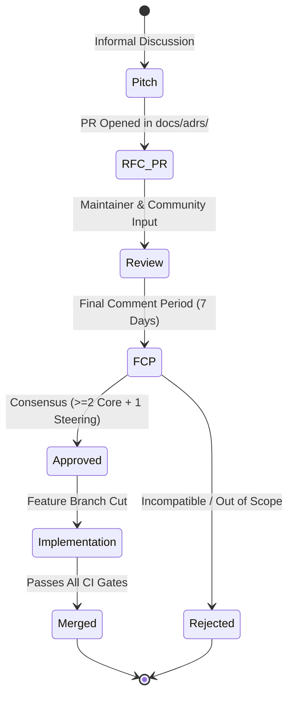

# NOVA Request for Comments (RFC) Process

This document defines the formal **Request for Comments (RFC)** process for proposing and evaluating non-trivial architectural, algorithmic, and governance changes to NOVA.

---

## Table of Contents

- [Purpose & Philosophy](#purpose--philosophy)
- [When is an RFC Mandatory?](#when-is-an-rfc-mandatory)
- [The Substrate vs. Product Evaluation Gate](#the-substrate-vs-product-evaluation-gate)
- [RFC Lifecycle States](#rfc-lifecycle-states)
  - [Phase 1: Informal Pitch](#phase-1-informal-pitch)
  - [Phase 2: Formal RFC Pull Request](#phase-2-formal-rfc-pull-request)
  - [Phase 3: Final Comment Period (FCP)](#phase-3-final-comment-period-fcp)
  - [Phase 4: Decision & Stewardship](#phase-4-decision--stewardship)
  - [Phase 5: Implementation & Verification](#phase-5-implementation--verification)
- [Mandatory RFC Questionnaire](#mandatory-rfc-questionnaire)
- [Standard RFC Document Template](#standard-rfc-document-template)

---

## Purpose & Philosophy

NOVA sits on the critical path of production generative inference streams. Because errors or architectural erosion directly compromise throughput, latency, and credential isolation, major design evolutions must undergo structured, rigorous peer review before implementation.

The RFC process ensures:
1. **Defensive Alignment:** Proposals are scrutinized for memory safety, non-blocking asynchronous behavior, and failure domain containment.
2. **Anti-Scope-Creep Enforcement:** Proposals are vetted to confirm they belong in an **autonomous out-of-process infrastructure substrate** and do not contaminate NOVA with product-layer logic.
3. **Institutional Memory:** The technical rationales, rejected alternatives, and trade-offs of major decisions are permanently documented for future maintainers.

---

## When is an RFC Mandatory?

An RFC is strictly required before submitting code for:
- Any modification to public HTTP or WebSocket protocol wire contracts (`/v1/*`).
- Any proposal introducing a new external runtime npm dependency.
- Any alteration to [db/schema.sql](file:///Users/bozoegg/Downloads/nova/db/schema.sql) tables, stored procedures, or transaction isolation semantics.
- Re-architecting scheduling algorithms (Smooth Weighted Round Robin, Continuous Token Buckets, BroccoliQueue 3-MinHeaps).
- Modifying cryptographic key derivation, vault encryption, or tenant privacy firewall boundaries.
- Any proposal modifying process boundaries or daemon topologies.

> [!NOTE]
> Standard bug fixes, internal refactorings that preserve public contracts, test expansions, and documentation enhancements do **NOT** require an RFC.

---

## The Substrate vs. Product Evaluation Gate

Before drafting an RFC, the author must verify that the proposed capability belongs within NOVA's infrastructure substrate:

```
┌─────────────────────────────────────────────────────────────┐
│                 RFC SCOPE EVALUATION GATE                   │
├─────────────────────────────────────────────────────────────┤
│  Is this feature intended for end-user product consumption  │
│  (e.g., UI screens, user passwords, payment billing, CRM)?  │
│                                                             │
│       YES ────────► ❌ REJECT (Belongs in Product Layer)    │
│        │                                                    │
│        NO                                                   │
│        ▼                                                    │
│  Does this feature require embedding NOVA in-process inside │
│  a client web/mobile/desktop application?                   │
│                                                             │
│       YES ────────► ❌ REJECT (Violates Standalone Mandate) │
│        │                                                    │
│        NO                                                   │
│        ▼                                                    │
│  ✅ PROCEED TO RFC AUTHORING                                │
└─────────────────────────────────────────────────────────────┘
```

---

## RFC Lifecycle States



### Phase 1: Informal Pitch
Before writing an extensive specification, authors open a discussion thread in GitHub Discussions under "RFC Ideas" or discuss it with maintainers. This prevents wasted effort on proposals that conflict with core invariants.

### Phase 2: Formal RFC Pull Request
The author submits a pull request adding a new document under `docs/adrs/` titled `RFC-XXXX-<proposal-name>.md` following the [Standard RFC Document Template](#standard-rfc-document-template).

### Phase 3: Final Comment Period (FCP)
When active review consensus appears close, a Core Maintainer calls for a **Final Comment Period (FCP)** lasting **7 calendar days**. During FCP:
- The RFC is labeled `fcp:review`.
- All maintainers and stakeholders are pinged for final review.
- Any unresolved technical objection pauses FCP until addressed.

### Phase 4: Decision & Stewardship
At the close of FCP:
- **Approved:** The RFC is renamed to `ADR-XXXX-<title>.md`, status updated to `Accepted`, and merged into `main`.
- **Rejected:** If the proposal violates scope boundaries or introduces unsustainable architectural trade-offs, it is merged as `Rejected` with a clear explanation of rationale, ensuring future contributors understand why the approach was declined.

### Phase 5: Implementation & Verification
Once accepted, implementation begins in a dedicated feature branch. Pull requests implementing the RFC must link directly to the accepted ADR and satisfy all CI gates.

---

## Mandatory RFC Questionnaire

Every RFC must answer each of the following six mandatory questions:

1. **Substrate vs. Product Justification:** Why must this capability live in the out-of-process inference relay rather than in external application services?
2. **Process Boundary Integrity:** Does this change maintain the standalone daemon model? Confirm that zero in-process embedding interfaces are introduced.
3. **Protocol Purity:** Does this adhere to standard OpenAI-compatible wire specifications, or does it introduce proprietary endpoints?
4. **Failure Domain Analysis:** If this component fails or encounters extreme load, does it contain failure locally without crashing the streaming relay?
5. **Zero-UI Invariant:** Confirm that zero HTML, CSS, client-side templates, or browser frameworks are introduced.
6. **Resource Bulkhead Impact:** Does this change risk unbounded memory growth, memory fragmentation, or Node.js event loop blocking?

---

## Standard RFC Document Template

```markdown
# RFC-XXXX: [Descriptive Title]

## Status
[Draft | Under Review | FCP | Accepted | Rejected | Superseded]

## Summary
[A concise 2-3 paragraph summary of what is being proposed.]

## Motivation
[Why is this change necessary? What production challenges does it solve?]

## Substrate vs. Product Separation
[Explicitly answer how this proposal respects the standalone infrastructure substrate boundary.]

## Detailed Technical Design
[Architecture diagrams, data structures, state machines, and API wire schemas.]

## Failure Domain & Security Analysis
[How does this component behave under failure? What are the security/cryptographic implications?]

## Alternatives Considered
[What alternative designs were explored and why were they rejected?]

## Unresolved Questions
[What aspects remain open for maintainer feedback?]
```
