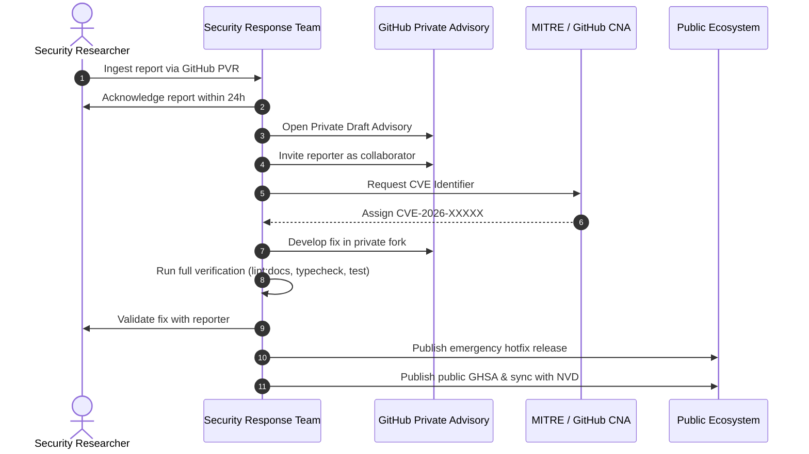

# Security Vulnerability Handling & Coordinated Disclosure

This document outlines the operational procedures for the **NOVA Security Response Team (SRT)** to intake, triage, patch, and publicly disclose security vulnerabilities under a coordinated disclosure model.

---

## Table of Contents

- [Security Response Team (SRT) Charter](#security-response-team-srt-charter)
- [Intake Channels & Confidentiality](#intake-channels--confidentiality)
- [Vulnerability Triage & CVSS v3.1 Scoring Matrix](#vulnerability-triage--cvss-v31-scoring-matrix)
- [Remediation Service-Level Agreements](#remediation-service-level-agreements)
- [Coordinated Vulnerability Disclosure (CVD) Workflow](#coordinated-vulnerability-disclosure-cvd-workflow)
  - [Phase 1: Ingestion & 24-Hour Acknowledgment](#phase-1-ingestion--24-hour-acknowledgment)
  - [Phase 2: Private Security Advisory (GHSA) Creation](#phase-2-private-security-advisory-ghsa-creation)
  - [Phase 3: CVE Identifier Reservation](#phase-3-cve-identifier-reservation)
  - [Phase 4: Private Patch Development & Backporting](#phase-4-private-patch-development--backporting)
  - [Phase 5: Embargo & Coordinated Release](#phase-5-embargo--coordinated-release)
  - [Phase 6: Public Disclosure & Ecosystem Notification](#phase-6-public-disclosure--ecosystem-notification)
- [Security Advisory Template](#security-advisory-template)

---

## Security Response Team (SRT) Charter

The NOVA Security Response Team (SRT) is an elite group of core maintainers tasked with safeguarding NOVA users, credentials, and infrastructure against security threats.

### SRT Responsibilities
- Monitor inbound vulnerability reports 24/7/365.
- Rapidly validate proof-of-concept exploits in isolated sandbox environments.
- Author robust, regression-free cryptographic and boundary patches.
- Coordinate responsibly with external security researchers and downstream enterprise consumers.

---

## Intake Channels & Confidentiality

Vulnerabilities must never be reported through public GitHub issues, public discussions, or pull requests.

Authorized intake channels include:
1. **GitHub Private Vulnerability Reporting (PVR):** Preferred channel for researchers with a GitHub account. Accessible via the repository's "Security" -> "Report a vulnerability" tab.
2. **Encrypted Security Email:** For researchers requiring GPG encryption, send reports to `security@nova-relay.internal` using the primary maintainer PGP key listed in [MAINTAINERS.md](file:///Users/bozoegg/Downloads/nova/MAINTAINERS.md).

---

## Vulnerability Triage & CVSS v3.1 Scoring Matrix

Upon report ingestion, the on-call SRT member must calculate a [Common Vulnerability Scoring System (CVSS v3.1)](https://www.first.org/cvss/v3.1/specification-document) score:

| Severity Level | CVSS v3.1 Score | Example Scenarios in NOVA | Target Action |
| :--- | :--- | :--- | :--- |
| **CRITICAL** | `9.0 – 10.0` | Remote Code Execution (RCE), unauthenticated token exfiltration from AES-256 vault, bypass of tenant isolation firewall. | Immediate emergency patch within 48h; out-of-band hotfix release. |
| **HIGH** | `7.0 – 8.9` | Unbounded memory exhaustion / DoS via malicious WebSocket framing, credential leakage in verbose error headers, privilege escalation in database stored procedures. | Patch within 7 days; targeted patch release. |
| **MEDIUM** | `4.0 – 6.9` | Local timing side-channel attack on HMAC verification, rate limit bypass via malformed headers, information disclosure in debug logs. | Patch within 14 days; bundled into next planned minor/patch. |
| **LOW** | `0.1 – 3.9` | Minor documentation ambiguity that could lead to misconfiguration, non-exploitable memory leak during node shutdown. | Addressed during normal maintenance cycle. |

---

## Remediation Service-Level Agreements

| Metric | Target SLA |
| :--- | :--- |
| **Initial Researcher Acknowledgment** | **$< 24$ hours** |
| **Initial Assessment & Reproducibility Confirmation** | **$< 48$ hours** |
| **Critical Severity Patch Authoring** | **$< 48$ hours** |
| **High Severity Patch Authoring** | **$< 7$ calendar days** |
| **Standard Coordinated Embargo Window** | **14 calendar days** (negotiable up to 30 days for complex enterprise mitigations) |

---

## Coordinated Vulnerability Disclosure (CVD) Workflow



### Phase 1: Ingestion & 24-Hour Acknowledgment
- Respond to the researcher within 24 hours confirming receipt.
- Establish an encrypted or private communication channel.
- Designate a Primary SRT Incident Commander.

### Phase 2: Private Security Advisory (GHSA) Creation
- Initialize a GitHub Security Advisory (GHSA) in `CardSorting/NOVA-AI`.
- Invite the reporting researcher as a collaborator to review findings and proposed solutions.
- Populate the advisory with reproduction steps, affected versions, and severity score.

### Phase 3: CVE Identifier Reservation
- Request a CVE identifier directly through the GHSA interface (GitHub serves as an authorized CVE Numbering Authority [CNA]).
- Record the reserved CVE (e.g. `CVE-2026-38101`) in the advisory draft.

### Phase 4: Private Patch Development & Backporting
- Utilize GitHub's private advisory fork feature to develop the remediation branch.
- Strictly adhere to the [Architectural Invariants](file:///Users/bozoegg/Downloads/nova/CONTRIBUTING.md#architectural-boundary-guarantees).
- Write automated regression tests asserting that the vulnerability is closed.
- Verify the patch across all supported releases (Active LTS + Current).

### Phase 5: Embargo & Coordinated Release
- Agree on a mutual disclosure date with the reporter (typically 14 days from patch readiness).
- Provide downstream enterprise users with an advance advisory notice under non-disclosure terms where applicable.
- Tag and build release packages containing the patch.

### Phase 6: Public Disclosure & Ecosystem Notification
- Merge the private advisory fork into `main`.
- Publish the official release to npm and container registries with GPG signature and SLSA provenance.
- Publish the GHSA publicly, broadcasting the CVE to the National Vulnerability Database (NVD).
- Credit the security researcher prominently in the advisory and CHANGELOG.

---

## Security Advisory Template

When drafting the public GHSA, maintainers must use the following standard format:

```markdown
### Impact
[Describe who is affected, what an attacker could achieve, and under what conditions.]

### Affected Versions
- NOVA `>= 1.0.0, < 1.0.4`

### Patched Versions
- NOVA `>= 1.0.4`

### Workarounds
[Detail temporary mitigations or configuration adjustments if an immediate upgrade is impossible.]

### Credit
This vulnerability was discovered and reported responsibly by [Researcher Name] (@handle).

### References
- [GitHub Security Advisory](https://github.com/CardSorting/NOVA-AI/security/advisories/GHSA-xxxx-xxxx-xxxx)
- [CVE-2026-XXXXX](https://nvd.nist.gov/vuln/detail/CVE-2026-XXXXX)
```
