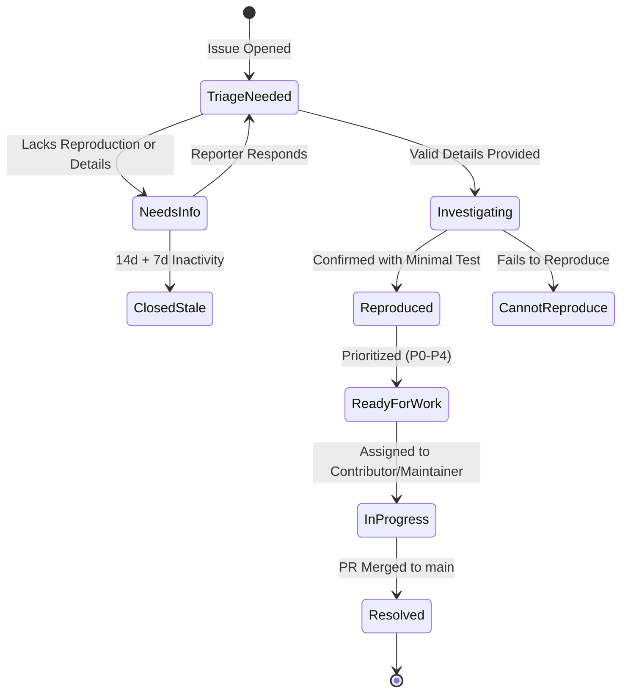

# Issue Triaging, Support & Community Governance

This document establishes the official issue triage protocols, priority taxonomies, minimal reproduction verification procedures, and automated stale-handling rules for **NOVA** maintainers and triagers.

---

## Table of Contents

- [Triage Philosophy & SLAs](#triage-philosophy--slas)
- [Issue State Machine](#issue-state-machine)
- [Priority & Severity Taxonomy](#priority--severity-taxonomy)
- [Minimal Reproduction Verification Protocol](#minimal-reproduction-verification-protocol)
- [Issue Type Gating & Redirects](#issue-type-gating--redirects)
  - [Bug Reports](#bug-reports)
  - [Feature Proposals](#feature-proposals)
  - [General Support & Questions](#general-support--questions)
- [Automated Stale Bot Governance](#automated-stale-bot-governance)
- [Labeling Taxonomy Reference](#labeling-taxonomy-reference)

---

## Triage Philosophy & SLAs

Issue triage is our mechanism for separating signal from noise, protecting maintainer focus, and validating community bug reports with speed and empathy.

Maintainers and triagers adhere to the following response targets:
- **P0 Blocker Issues:** Triage within **12 hours**.
- **P1 Critical Issues:** Triage within **24 hours**.
- **Standard Issues (P2-P4):** Initial response within **48 hours**.

---

## Issue State Machine

Every issue follows a deterministic lifecycle from creation to resolution:



---

## Priority & Severity Taxonomy

All actionable issues must be categorized with exactly one priority label:

| Priority Label | Severity Description | Criteria & Impact | Maintainer Response Action |
| :--- | :--- | :--- | :--- |
| `P0-blocker` | **Service Outage / Data Loss** | Entire gateway crashing, database corruption, credential leakage, or unauthenticated API compromise. | Drop all in-flight work. Page on-call team. Patch immediately. |
| `P1-critical` | **Core Capability Broken** | Complete failure of WebSocket streaming relay, severe memory leak in queue, or persistent 500 errors across all tenants. | High priority. Assigned maintainer must triage within 24h. |
| `P2-high` | **Feature Degraded with Workaround** | Rate governor window calculation drift under extreme load, minor token bucket leakage, or CLI sub-command failure. | Scheduled for upcoming sprint or patch release. |
| `P3-normal` | **Minor Defect or Discrepancy** | Logging format discrepancy, documentation typo, non-breaking cosmetic edge case in error messages. | Open to community contributions with `good-first-issue` label. |
| `P4-backlog` | **Low Priority Enhancement** | Optional ergonomics tweak, non-urgent refactor, long-term speculative ideas. | Reviewed quarterly during roadmap planning. |

---

## Minimal Reproduction Verification Protocol

A bug report cannot be marked as `status:reproduced` or assigned priority until a maintainer has verified the defect using an isolated reproduction.

### Maintainer Verification Checklist
1. **Isolated Reproduction:** Demand a self-contained script or test using native Node.js:
   ```bash
   node --test repro.test.mjs
   ```
2. **Environment Verification:** Confirm Node.js version (`>= 20.0.0`), operating system, and whether local mock relays or live endpoints were used.
3. **Subsystem Isolation:** Determine if the failure originates in:
   - `src/queue` (in-process BroccoliQueue MinHeap)
   - `src/relay` (WebSocket streaming relay & token bucket)
   - `src/pool` (SWRR account leasing)
   - `src/db` (PostgreSQL relational execution store)
4. **Reproducibility Labeling:**
   - If confirmed: Apply `status:reproduced` and appropriate priority label (`P0`-`P4`).
   - If unconfirmed: Apply `status:cannot-reproduce` and ask the reporter for missing environmental context.

---

## Issue Type Gating & Redirects

### Bug Reports
- Must use the official Bug Report issue template.
- Must provide system information, exact error logs, and reproduction steps.
- If incomplete, apply `status:needs-info` with a polite request for required details.

### Feature Proposals
- Substantial architectural proposals must follow the [Architecture Governance Process](./architecture-governance.md) and be submitted as an Architecture Decision Record (ADR) pull request.
- Smaller feature requests are evaluated based on alignment with NOVA's core mission (headless inference relay). Features introducing client UI dependencies or third-party queue engines are closed immediately with an explanation.

### General Support & Questions
- Issues asking "How do I configure my upstream provider?" or "How do I deploy on cloud X?" are gently redirected to **GitHub Discussions** or community forums, and the issue is closed as `type:question`.

---

## Automated Stale Bot Governance

To keep the issue backlog pristine and prevent dead issues from lingering indefinitely:

1. **Warning Phase:** If an issue marked `status:needs-info` receives no activity from the reporter for **14 consecutive days**, the bot posts a friendly warning asking if the issue is still relevant.
2. **Closure Phase:** If no response is received within **7 additional days** (21 total days), the bot closes the issue with a note explaining that it can be reopened when full reproduction steps are available.
3. **Exemptions:** Issues bearing any of the following labels are strictly exempt from stale bot actions:
   - `pinned`
   - `roadmap`
   - `security`
   - `P0-blocker`
   - `P1-critical`

---

## Labeling Taxonomy Reference

| Category | Available Labels | Description |
| :--- | :--- | :--- |
| **Status** | `status:needs-info`, `status:investigating`, `status:reproduced`, `status:cannot-reproduce`, `status:ready-for-work`, `status:in-progress` | Current stage in the triage lifecycle. |
| **Priority** | `P0-blocker`, `P1-critical`, `P2-high`, `P3-normal`, `P4-backlog` | Urgency and impact rating. |
| **Subsystem** | `area:queue`, `area:relay`, `area:pool`, `area:db`, `area:cli`, `area:docs` | Codebase component affected. |
| **Community** | `good-first-issue`, `help-wanted`, `beginner-friendly` | Accessible entry points for contributors. |
| **Type** | `type:bug`, `type:feature`, `type:docs`, `type:security`, `type:question` | Nature of the submission. |
